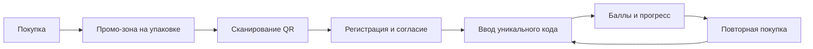

# TAMYR POP: промо-механика

## 5.1 Путь покупателя

| Шаг | Что делает покупатель | Что видит | Где |
| --- | --- | --- | --- |
| 1 | Покупает курт | Промо-зона и упаковка | Точка продаж / упаковка |
| 2 | Замечает QR | Призыв перейти на TAMYR POP | Лицевая сторона упаковки |
| 3 | Сканирует QR | Главная страница с механикой | Лендинг |
| 4 | Регистрируется и даёт согласие | Короткая форма до 5 полей и ссылки на документы | Лендинг |
| 5 | Вводит код изнутри | Результат проверки и начисление баллов | Лендинг |
| 6 | Возвращается | Прогресс, следующая награда и история | Кабинет |
| 7 | Покупает снова и вводит новый код | Следующий уровень прогресса | Упаковка / лендинг |

## 5.2 Сбор данных

| Вопрос | Решение |
| --- | --- |
| Почему лендинг | QR ведёт к единой мобильной точке участия и кабинету прогресса. |
| Поля | Имя, телефон, город, возрастная группа, уникальный код (необязательно при регистрации): 5 полей. |
| Согласие | Отдельный пустой по умолчанию checkbox, версия и время согласия сохраняются в `ConsentRecord`. |
| Где код | Внутри упаковки или под отрывной частью. |

## 5.3 Награды

| Количество кодов | Награда | Вид | Ориентировочная стоимость |
| --- | --- | --- | --- |
| 3 | ЗАПОЛНИТЬ | ЗАПОЛНИТЬ | ЗАПОЛНИТЬ |
| 5 | ЗАПОЛНИТЬ | ЗАПОЛНИТЬ | ЗАПОЛНИТЬ |

Конфигурация 1 код = 1 балл, 3 балла = гарантированная награда и 5 баллов = участие в розыгрыше есть только в DEMO и помечена как предварительная; она не является публичным обещанием.

## 5.4 Сценарии удержания

| Когда | Канал | KZ | RU |
| --- | --- | --- | --- |
| После успешного кода | SMS / подключённый провайдер | `Кодыңыз қабылданды. Прогресіңіз кабинетте көрсетілген.` | `Код принят. Ваш прогресс доступен в кабинете.` |
| Через несколько дней | SMS, только с отдельным согласием | `Прогресіңізді тексергіңіз келсе, кабинетке кіріңіз. Хабарламадан бас тартуға болады.` | `Если хотите, проверьте прогресс в кабинете. От сообщений можно отказаться.` |
| При достижении порога | SMS / подключённый провайдер | `Келесі деңгейге жеттіңіз. Мәлімет кабинетте.` | `Вы достигли следующего уровня. Подробности — в кабинете.` |

Шаблоны должны быть вычитаны носителем казахского языка и юристом до отправки. Без согласия маркетинговые сообщения не планируются.

## 5.5 Показатели

| Показатель | Серверный расчёт |
| --- | --- |
| Регистрации | Число `User` с ролью `PARTICIPANT`. |
| Повторные участники | Пользователи с двумя и более разными `CodeRedemption`; доля = повторные / участники с ≥1 кодом × 100 %. |
| Активные участники | Пользователи, зарегистрировавшие хотя бы один код в выбранный период. |

Дополнительно в админке показывается конверсия регистрация → активация и число выданных наград.
